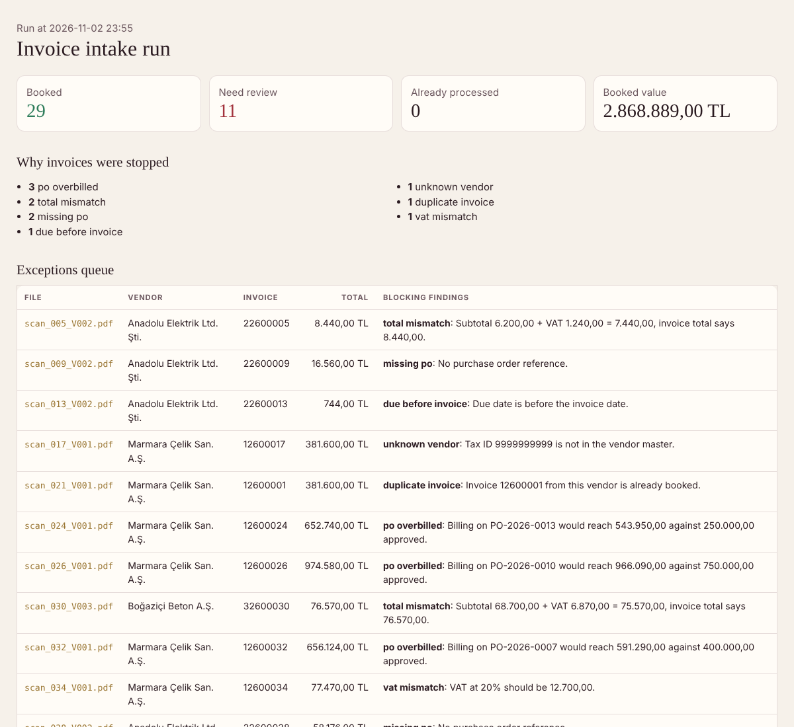
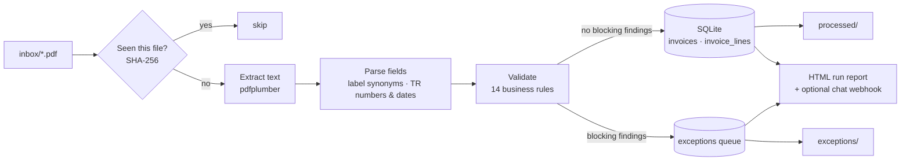
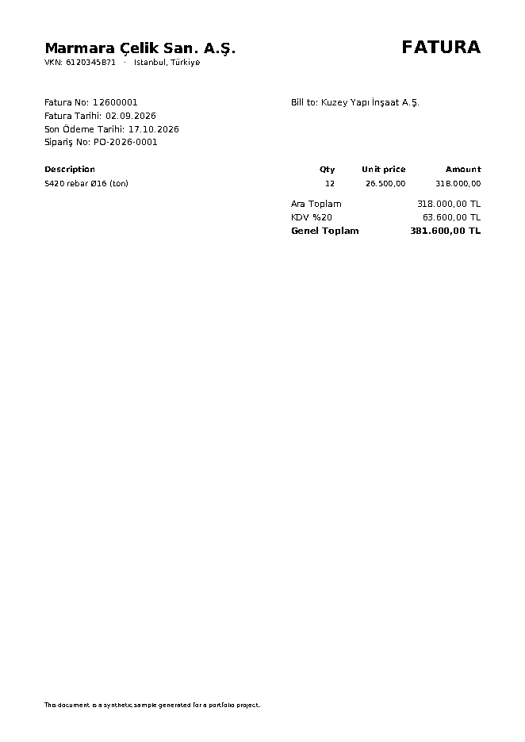

# Invoice Intake Automation

**Supplier invoices arrive as PDFs in different layouts. This pipeline reads them, checks them against vendor and purchase-order master data, books the clean ones into a database and routes the rest to an exceptions queue with the reason written out.**



## The problem

Accounts payable in a construction company receives invoices from steel, electrical and concrete suppliers, each with its own layout and its own words for the same field (`Fatura No`, `Invoice No`, `Belge No`). Keying them in by hand is slow, and the expensive mistakes are not typos: paying the same invoice twice, paying against a PO that is already used up, or paying a total that does not add up.

## What it does



1. **Extract**: text is read from each PDF. Each field has a list of label synonyms in Turkish and English, so one parser handles all three vendor layouts; the longest matching label wins (`Hesaplanan KDV` before `KDV`).
2. **Normalise**: Turkish money (`1.234.567,89`) and dates (`31.12.2026`) become numbers and dates.
3. **Validate** against `master_data/vendors.csv` and `master_data/purchase_orders.csv`:

| Rule | Severity |
|---|---|
| Required field could not be read | error |
| Tax ID not in the vendor master | error |
| Line `qty × price` ≠ line amount; lines ≠ subtotal | error |
| Subtotal + VAT ≠ total; VAT ≠ rate × subtotal | error |
| Due date before invoice date | error |
| Same vendor + invoice number already booked | error |
| No PO, unknown PO, PO belongs to another vendor | error |
| Cumulative billing would exceed the approved PO amount | error |
| More than 90 % of the PO now billed | warning |
| VAT rate other than 1 %, 10 %, 20 % | warning |

4. **Book or reject**: clean invoices go to SQLite with their lines; the rest go to the exceptions table with every finding stored as JSON. Files are moved to `output/processed/` or `output/exceptions/`.
5. **Idempotent**: every file is recorded by its SHA-256 hash, so running the job again on the same folder books nothing twice.
6. **Report**: an HTML summary of the run, and a one-line message to a Slack, Teams or Discord-style incoming webhook if `INTAKE_WEBHOOK_URL` is set.

## Results on the sample inbox

40 synthetic invoices from 3 vendors, nine of them seeded with a known problem:

| | |
|---|---|
| Booked | **29** invoices, 2.87 M TL |
| Stopped for review | **11** |
| Reasons | 3 PO overbilled · 2 total mismatch · 2 missing PO · 1 duplicate · 1 unknown vendor · 1 VAT mismatch · 1 due date before invoice date |
| Second run on the same files | 40 skipped, 0 booked |

Two of the three overbilled POs were not seeded: they came from ordinary invoices adding up past the approved amount, which is exactly the case this rule is for.



## Run it

```bash
pip install -e ".[dev]"
python scripts/make_sample_invoices.py   # 40 PDFs in inbox/ + master data
invoice-intake --keep-files              # or: python -m invoice_intake.pipeline
open output/run_report.html
pytest -q
```

Options: `--inbox`, `--master`, `--db`, `--out`, `--report`, `--keep-files`.

## Structure

```
src/invoice_intake/
  extract.py    PDF text → Invoice (label synonyms, Turkish formats, line items)
  validate.py   business rules → findings (error / warning)
  store.py      SQLite schema, booking, exceptions, file hashes
  pipeline.py   orchestration, file routing, webhook, CLI
  report.py     HTML run report
scripts/make_sample_invoices.py   synthetic PDFs (reportlab, DejaVu fonts for Turkish characters)
master_data/                      vendors and purchase orders
tests/                            parsing, every rule, end-to-end and idempotency
```

## Design choices

- **Rules over templates.** Label synonyms scale to a new vendor by adding a word, not a template.
- **Errors block, warnings inform.** A nearly used PO should not stop payment, but someone should know.
- **Findings are data.** Stored as JSON per invoice, so the exceptions queue can feed a dashboard or a ticketing tool.
- **Scanned images** would need an OCR step (for example Tesseract) in front of `extract_pdf`; the rest of the pipeline stays the same.

All vendors, tax IDs and invoices are synthetic.
